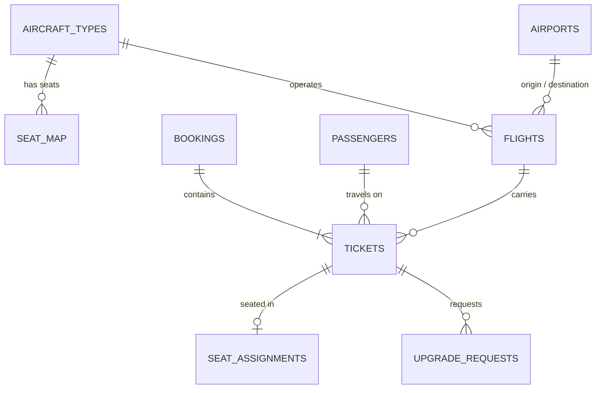

# ✈️ Airline Seat Management — SQL Analytics Project

A relational database and a set of analytical SQL queries for a (fictional) airline operating out of **Barcelona (BCN)**.
The queries answer the questions a revenue-management, operations or customer-experience team asks every day:
which flights are overbooked, which families were seated apart, who gets the free upgrade, and is anyone under 15
sitting in an emergency-exit row?

> **Skills shown:** relational data modelling · CTEs · window functions (`ROW_NUMBER`, `RANK`, `LAG`, moving averages, `SUM() OVER`) ·
> anti-joins · conditional aggregation · views · data-quality rules · a seat-assignment algorithm written in pure SQL.
> Runs on **PostgreSQL 16** and **DuckDB** with the same results.

---

## The data

| Table | Rows | What it holds |
|---|---:|---|
| `airports` | 8 | BCN plus 7 destinations (MAD, LIS, FCO, CDG, LHR, JFK, GRU) |
| `aircraft_types` | 3 | A320neo, Boeing 737-800, A330-300 |
| `seat_map` | 662 | Every physical seat: row, letter, cabin, Window/Middle/Aisle, exit row |
| `flights` | 232 | 3 weeks of flights (15 Oct – 4 Nov 2026), departed and scheduled |
| `passengers` | ~10,000 | Adults and children, loyalty tier and points |
| `bookings` | ~22,000 | Booking reference, channel; one booking can hold a whole family |
| `tickets` | ~38,500 | One passenger on one flight: cabin, fare, seat preference, status |
| `seat_assignments` | ~33,000 | Which seat each ticket got, and how (self-selected or auto) |
| `upgrade_requests` | ~600 | Upgrade bids from Economy/Premium passengers |

The data is synthetic and reproducible (`scripts/generate_data.py`, fixed random seed). It deliberately contains realistic problems
— oversold flights, split families, a few children in exit rows — so the queries have something real to find.



A `UNIQUE (flight_id, seat_no)` constraint guarantees a seat can never be sold twice on the same flight.

---

## Business questions answered

| # | Question | Key SQL techniques |
|---|---|---|
| [Q1](queries/01_seat_availability.sql) | How many seats are left on each upcoming flight, by cabin? | View, conditional aggregation |
| [Q2](queries/02_load_factor_by_route.sql) | Load factor per flight, rank within route, 7-flight rolling average | `RANK()`, `AVG() OVER (ROWS BETWEEN 6 PRECEDING …)` |
| [Q3](queries/03_overbooking_risk.sql) | Which flights are overbooked after expected no-shows? | Multiple CTEs, historical rate applied to future demand |
| [Q4](queries/04_split_families.sql) | Which booking groups were seated apart, and which travel with children? | `LAG()` seat-adjacency logic, `STRING_AGG` |
| [Q5](queries/05_auto_assign_seats.sql) | Propose seats for unseated passengers, honouring Window/Aisle preference and loyalty | Two-pass matching with `ROW_NUMBER()`, anti-joins, `UNION ALL` |
| [Q6](queries/06_upgrade_waitlist.sql) | Who gets upgraded to Business? | Waitlist ranking with `ROW_NUMBER()`, capacity CTE |
| [Q7](queries/07_revenue_per_seat.sql) | Which route/cabin earns most per available seat? | Revenue per seat, `SUM() OVER (PARTITION BY …)` share |
| [Q8](queries/08_seat_preference_fulfilment.sql) | Do passengers get the seat type they asked for? | Conditional aggregation |
| [Q9](queries/09_exit_row_safety_check.sql) | Safety audit: any under-15s in an exit row? | Age at departure, data-quality rule |

Full outputs for every query are in [`results/`](results).

---

## Highlights

**Overbooking (Q3).** 23 upcoming Economy cabins are sold above 95% of capacity. Applying each route's historical no-show rate
(≈6–7%) shows that 12 are covered by expected no-shows, but **8 still won't fit and need action now**:

| flight_no | destination | departure | seats | confirmed | hist. no-show % | expected show-ups | risk_flag |
|---|---|---|---:|---:|---:|---:|---|
| ZZ1501 | LHR | 2026-10-31 10:30 | 162 | 191 | 6.9 | 178 | Overbooked - act now |
| ZZ1003 | MAD | 2026-10-31 13:30 | 162 | 190 | 6.7 | 177 | Overbooked - act now |
| ZZ1501 | LHR | 2026-10-30 10:00 | 162 | 187 | 6.9 | 174 | Overbooked - act now |

**Split families (Q4).** Of ~9,500 multi-passenger bookings, **1,415 were not seated in one continuous block**,
and **483 of those include children** — the cases a customer-service team should fix first.
The query finds them by ordering each group's seats with `LAG()` and checking whether every passenger sits directly next to the previous one.

| booking_ref | flight_no | group_size | children | rows_apart | seating |
|---|---|---:|---:|---:|---|
| UT77H7 | ZZ1203 | 4 | 2 | 28 | Sofia 4C, Jordi 6B, Elena 14B, Lucía 32F |
| 27AFWT | ZZ1201 | 4 | 2 | 27 | Hugo 4A, Marta 20C, Olivia 25A, Ana 31C |

**Automatic seat assignment in pure SQL (Q5).** For 3,211 confirmed passengers without a seat, the query first matches
Window/Aisle requests to free seats of that type (loyal customers first), then places everyone else in the best remaining seat.
Result: **1,950 preferences met, 1,040 with no preference, only 221 preferences that couldn't be met.** Exit rows are excluded
from automatic assignment.

**Upgrade waitlist (Q6).** 589 Business upgrade requests ranked by tier → points → request time against the real number of
free Business seats: **371 upgrades, 218 waitlisted.**

**Revenue per available seat (Q7).** Long-haul Business earns the most per seat flown (JFK €1,123, GRU €959), but Premium Economy
on JFK brings in more total revenue than Business (21.6% vs 20.2% of the route).

**Seat preference (Q8).** Self-selected seats match the requested type far more often than auto-assigned ones
(Aisle 65% vs 52%, Window 55% vs 42%) — an argument for nudging passengers to choose their seat in the app.

**Safety (Q9).** 12 passengers under 15 were assigned an emergency-exit row; one is on an upcoming flight and is flagged
*Reseat before departure*.

---

## How to run

**Option A — DuckDB (no database server needed)**
```bash
pip install duckdb
python scripts/run_all.py          # builds the DB in memory, runs every query, writes results/*.md
```

**Option B — PostgreSQL**
```bash
createdb airline
psql -d airline -f sql/01_schema.sql -f sql/02_load_postgres.sql -f sql/03_views.sql
psql -d airline -f queries/03_overbooking_risk.sql
```

To regenerate the sample data: `python scripts/generate_data.py`.

## Repository structure

```
sql/        01_schema.sql · 02_load_duckdb.sql · 02_load_postgres.sql · 03_views.sql
queries/    01 … 09 — one business question per file, commented
data/       CSV sample data (synthetic)
results/    query outputs as Markdown tables
scripts/    generate_data.py · run_all.py
```

---

*Author: **Valentina Simao** — Industrial Engineer & Data Analyst, Barcelona ·
[LinkedIn](https://www.linkedin.com/in/valentina-s-b79264150)*
*All airline names, flight numbers and passengers are fictional.*
